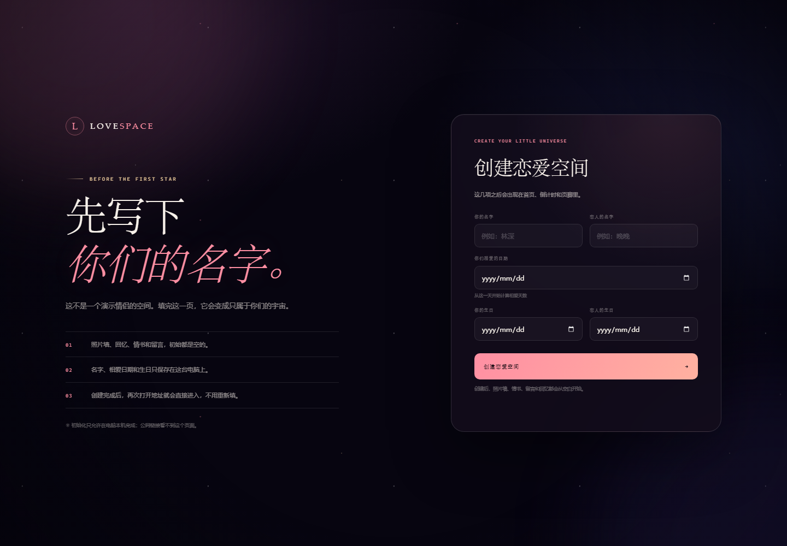
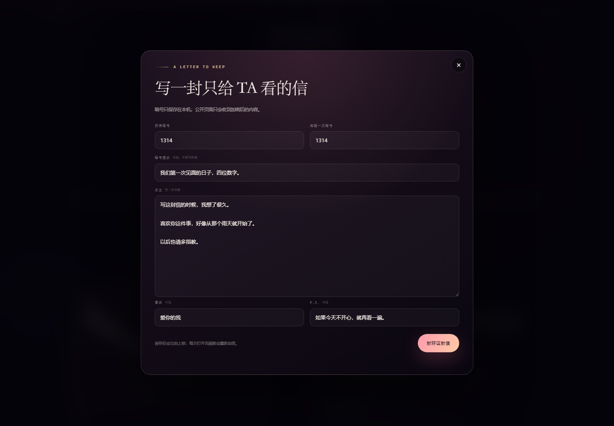
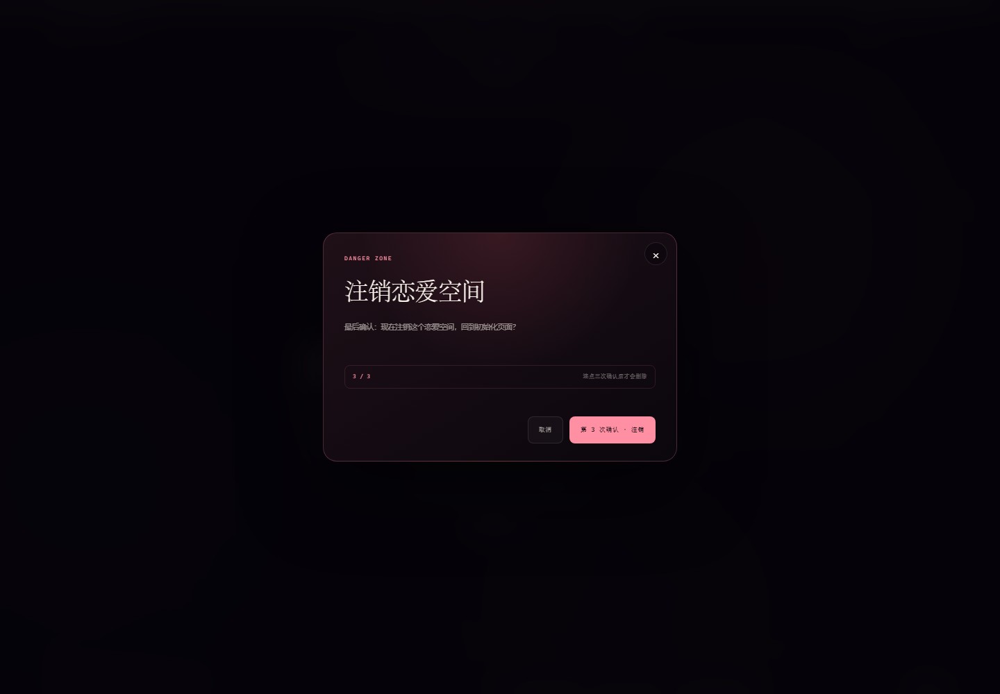

# LoveSpace

一个可以自己部署的恋爱宇宙：照片墙、恋爱计时、小世界，以及小游戏、情书、留言簿、公网分享、Markdown 回忆录和恋爱小助手。

零依赖、无构建、无数据库。所有内容保存在本机文件里，第一次打开先创建你们的空间，之后照片、回忆、情书和留言都从空白开始。

## 现在就能跑

需要 Node.js 20 或更高版本。

~~~bash
npm start
~~~

打开 <http://localhost:4321>。

第一次打开会进入初始化页：填写你的名字、恋人的名字、相爱日期和两个人的生日，点“创建恋爱空间”。

创建完成后会直接进入你们的页面；之后再打开同一个地址，不会重复初始化。

不需要安装任何依赖，也不需要构建。照片和文字都放在 content/ 里，改完刷新即可。

## 预览

| 首次初始化 | 写情书 | 注销三次确认 |
| --- | --- | --- |
|  |  |  |

## 已包含

- 首次打开初始化：填写两个人名字、相爱日期和生日，创建后保存
- 初始化后名字、纪念日、生日会进入首页、倒计时和页脚
- 照片墙、回忆、情书、留言初始都是空的，不附带演示情侣数据
- 星空首页，鼠标移动会有轻微视差
- 两个人的轨道视觉
- 相爱天数、小时、分钟、秒实时计时
- 下一次见面倒计时
- 照片墙，按年份筛选
- 点击照片打开大图，支持左右键、Esc 和手机滑动
- Markdown 恋爱时间线
- 星光捕手小游戏：接爱心、星星和记忆碎片，避开乌云
- 连击、最高分、结算情话和记忆碎片收藏
- 密码情书：信封、蜡封、暗号输入、错误提示、拆信动画和纸信样式
- 网页写情书：本机写信、设置并确认暗号、填写提示/正文/署名/P.S.，可再次编辑
- 情书正文用 PBKDF2 + AES-256-GCM 加密，公开数据里不出现暗号和明文
- 留言簿：名字 + 一句话，保存到本地，留言墙实时更新
- 空状态、字数计数、错误提示、提交成功反馈和移动端布局
- Cloudflare Tunnel 一键分享：自动启动或复用本地服务，生成临时公网链接
- 自动下载 cloudflared、复制链接、写入 .share-url.txt，Ctrl+C 同时停止
- Markdown 回忆录：从 content/memories 生成带目录、统计和照片引用的长文
- 网页新建回忆：本机打开时显示入口，填完自动生成 Markdown 文件
- 网页上传封面：自动压缩到最长边 1600px 的 JPEG，并登记进照片墙
- 删除回忆：时间线卡片上的 ×，只删回忆，照片保留
- 照片墙管理：添加照片、删除照片；被回忆当作封面时禁止删除
- 注销恋爱空间：页脚入口，连续三次确认后清空配置和所有内容
- 入口只在 localhost 显示，公网链接自动隐藏，API 也只接受本机请求
- 桌面、平板、手机自适应
- 减少动态效果的系统设置适配

## 第一次打开：创建你们的空间

初始化页只允许在电脑本机打开，填写：

- 你的名字
- 恋人的名字
- 你们相爱的日期
- 你的生日
- 恋人的生日

点“创建恋爱空间”后，会生成 content/site.json，并把名字、日期和生日写进去。照片墙、回忆、情书和留言会从空白开始。

创建完成后，下次打开 http://localhost:4321 会直接进入你们的页面；/setup 会自动跳回首页。

想重新初始化，可以删除 content/site.json，再打开 /setup。注意创建时会清空当前的回忆、照片记录和留言。

## 之后再修改

初始化后，主要内容在 content/site.json：

- couple.me / couple.her：名字
- couple.anniversary：相爱日期
- couple.birthdays.me / couple.birthdays.her：生日
- couple.city：城市
- next.date：下一次见面的时间
- hero / gallery / timeline / footer：页面文案

照片和回忆建议直接用网页里的添加入口管理。

### 情书

初始化后情书是空的，页面会显示“情书还没有写”，并出现本机可见的“写给 TA 的第一封信”按钮。

点开后填写：

- 拆信暗号，并再输入一次确认
- 暗号提示（不要写答案）
- 正文（空一行分段）
- 署名
- P.S.

保存后，页面会变成正常的拆信入口；本机还会出现“编辑这封信”。

暗号只保存在本机 content/site.json。服务端用 PBKDF2 派生密钥，再用 AES-256-GCM 加密正文；发送给浏览器的 data.js 里没有暗号，也没有明文段落。

通过 Cloudflare 公网访问时，只能拆信，不能写或改。

这防的是“顺手翻源码”，不是专业攻击。真的重要的隐私，不要只靠一个四位数字。

完整初始化说明见 [首次初始化文档](docs/setup.md)。

### 留言簿

留言保存在 data/guestbook.json，服务端限制每个 IP 每分钟最多 5 条、最多保留 200 条。删除 data/guestbook.json 就可以清空留言墙；公网分享时，任何拿到链接的人都可以留言，请记得这一点。

### Cloudflare Tunnel 一键分享

~~~bash
npm run share
~~~

分享前先在本机完成首次初始化；未初始化的公网链接不会显示创建页面。

它会在需要时自动启动本地服务，并建立 Cloudflare Quick Tunnel，打印一个临时公网链接。

**不需要预先安装 Cloudflare Tunnel。** 第一次运行会自动把 cloudflared 下载到 .tools/，之后复用；下载会先试 GitHub，失败再试公共镜像。

如果网络连镜像也访问不了，脚本会提示手动安装；也可以用 `CLOUDFLARED_BIN` 指向已有的 cloudflared。

保持终端窗口打开，链接才会有效；按 Ctrl+C 停止分享。每次重新运行都会生成新链接。

如果手机显示 Error 1033，先确认终端没有关闭，再试 `npm run share -- --port 4322 --protocol http2`。

临时隧道是公网可访问的，分享前请检查照片、文字和留言，不要发不想公开的内容。完整参数、Named Tunnel 和排错说明见 [Cloudflare Tunnel 文档](docs/cloudflare-tunnel.md)。

### Markdown 回忆录

~~~bash
npm run memoir
~~~

从 content/memories/ 生成 dist/MEMOIR.md：按时间正序，自动带书名、统计、目录、锚点、金句、标签和照片引用。

原稿仍是 content/memories/ 里的 Markdown；重新运行会覆盖生成文件。用 Typora、Obsidian 或 VS Code 打开，也可以再用 Pandoc 转 PDF。完整说明见 [回忆录文档](docs/memoir.md)。

### 在网页里新建回忆

不需要懂 Markdown。用电脑本机打开：

~~~text
http://localhost:4321
~~~

进入“时间线”，点击“+ 新建回忆”，填日期、标题、地点、心情、正文，保存即可。

保存后会自动生成：

~~~text
content/memories/YYYY-MM-DD-标题.md
~~~

页面会刷新，新回忆出现在时间线最上面。之后再运行 npm run memoir，回忆录里也会自动多一篇。

封面可以从已有照片墙里选择，也可以直接上传新照片。上传会在浏览器里压缩到最长边 1600px 的 JPEG，保存到 content/media/photos/，登记进 content/photos.json，并同时出现在照片墙。

注意：这个入口只在**电脑本机**打开时出现。通过 Cloudflare 公网链接访问时，按钮会自动隐藏，接口也会拒绝写入。

### 删除回忆和照片

删除回忆：鼠标移到时间线卡片上，右上角会出现 ×。确认后会删除 content/memories/ 里的 Markdown 文件。它用过的封面照片会保留在照片墙。

照片墙：点“+ 添加照片”可以单独上传照片，不一定要新建回忆。鼠标移到照片上，右上角会出现 ×，可以删除照片。

如果这张照片还是某篇回忆的封面，删除会被拒绝，并提示先换封面或删掉那篇回忆。这是为了避免回忆里出现坏图。

删除是直接删除文件，没有回收站；确认框里点取消就不会动。

### 注销恋爱空间

页脚有“注销恋爱空间”。点开后需要连续三次确认，才会真正删除。

注销会清空：

- 名字、相爱日期、生日和全部页面配置
- 照片墙和照片文件
- 回忆
- 情书
- 留言
- 生成的回忆录

完成后会回到首次初始化页面，就像刚拿到这个项目一样。

注销只允许在电脑本机操作；公网看不到入口，接口也会返回 403。没有回收站，确认前请自己备份。

回忆是一篇篇 Markdown，放在 content/memories/。每篇头部用简单的 frontmatter：

~~~markdown
---
date: 2025-01-26
title: 初雪落在你睫毛上
place: 杭州
mood: 温柔
tags: [初雪, 冬天]
cover: media/photos/first-snow.svg
quote: 你说雪落下来没有声音，可我听了一整晚。
---

正文……
~~~

## 测试

~~~bash
npm test
~~~

测试会使用系统临时目录，不会碰你的真实内容。

## 目录

~~~text
content/            运行时数据：配置、照片、回忆
web/                页面、样式和交互
lib/                内容解析、初始化、情书和照片写入
scripts/            分享与回忆录工具
docs/               初始化、分享和回忆录文档
tests/              零依赖 smoke tests
server.js           零依赖本地服务器
~~~

## 部署

最简单的部署是“自己的电脑 + Cloudflare Tunnel”，不需要服务器。

也可以部署到 VPS，用 Caddy + systemd 固定域名；初始化和管理通过 SSH 隧道完成。

完整步骤见 [部署指南](docs/deploy.md)。

## 上传到 GitHub

这个目录已经是一个 Git 仓库，并包含一个初始提交。

在 GitHub 新建一个空仓库，然后：

~~~bash
git remote add origin https://github.com/<your-account>/lovespace.git
git branch -M main
git push -u origin main
~~~

个人数据已经写进 .gitignore：

~~~text
content/site.json
content/photos.json
content/memories/*.md
content/media/photos/*
data/guestbook.json
~~~

所以正常 `git add .` 不会把名字、照片、回忆和留言提交上去。

如果手动压缩整个文件夹上传，请先确认压缩包里没有这些文件。可以用 `git archive` 生成干净源码包：

~~~bash
git archive --format=zip -o lovespace-source.zip HEAD
~~~

GitHub Pages 只能托管静态页面，不能运行 Node 服务和写入文件。这个项目需要部署在支持 Node.js 和持久磁盘的地方，例如自己的电脑、VPS、Render 或 Fly.io。

## 参与贡献

- [贡献说明](CONTRIBUTING.md)
- [安全问题](SECURITY.md)

## License

[MIT](LICENSE)

技术是冷的，但用技术爱你这件事，是热的。
